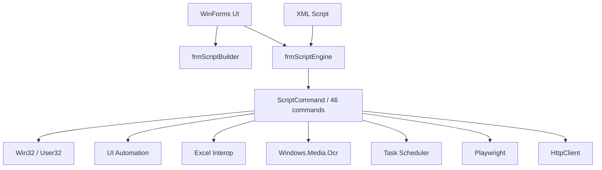
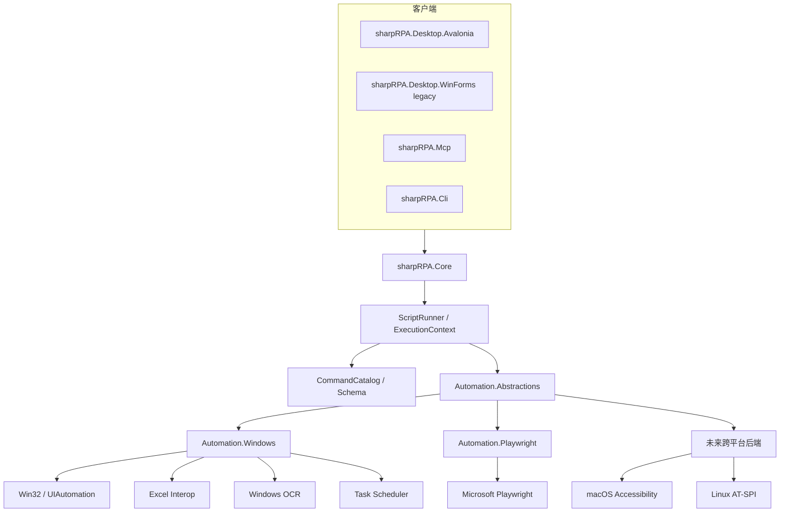

# sharpRPA 架构评估与演进路线

本文整理当前架构、目标架构，以及 Avalonia、MCP、Agent 自动记录/回放三项能力的可行性和实施顺序。

## 0. 当前进度

| 阶段 | 状态 | 说明 |
| --- | --- | --- |
| Phase 0 Core 解耦 | ✅ 完成 | 拆出 `sharpRPA.Core`（`net10.0`，无平台依赖）与 `sharpRPA.Windows`；命令改为 `IScriptExecutionContext`，`ScriptRunner` 支持无头执行、取消、暂停、进度、清理回调 |
| 录制事件边界 | ✅ 完成 | `RecordedAction` / `IRecordingSink` / `InMemoryRecordingSink`，浏览器与桌面录制共用 |
| 可测试性 | ✅ 完成 | `sharpRPA.Tests` 59 个用例，跨平台运行（含真实 sample 脚本往返、MCP 进程级集成测试） |
| Phase 1 MCP | ✅ 完成 | `sharpRPA.Mcp` stdio server，9 个工具，跨平台腿 + Windows 全命令腿 |
| Phase 2 自动录制 | ⬜ 未开始 | 浏览器 Playwright recorder、Windows UIA 录制 |
| Phase 3 Avalonia | ⬜ 未开始 | 视产品需要 |

## 1. 结论

| 方向 | 可行性 | 优先级 | 判断 |
| --- | --- | --- | --- |
| Avalonia 迁移 | 技术可行 | 低 | 不是直接升级，而是 UI 重写和平台能力解耦；Windows-only 时收益有限 |
| MCP 集成 | 可行性高 | 高 | 改造量中等、ROI 最高，应优先实施 |
| 自动记录/回放 | 浏览器和 Windows 桌面可行 | 中 | 难点是选择器稳定性、安全和跨平台桌面录制 |
| 三者关系 | MCP 不依赖 Avalonia | - | 先做无头执行引擎 + MCP，再做录制，最后按需做 Avalonia |

当前技术栈：

- .NET 10。`sharpRPA.Core` 目标 `net10.0`，UI 与 Windows 命令层目标 `net10.0-windows10.0.19041.0`。
- WinForms UI，约 15 个视图、47 个 UI 文件。
- 46 个 `ScriptCommand` 命令类：25 个跨平台（Core），21 个 Windows 专属（Windows 层）。
- 浏览器自动化已迁移到 Microsoft Playwright 1.64.1。
- 脚本格式为 XML，通过 `XmlSerializer` 序列化。
- Windows 专属能力：Win32 窗口/键鼠、UIAutomation、Excel Interop、WinRT OCR、Task Scheduler。

## 2. 当前架构



主要耦合和阻塞：

1. 命令通过 `RunCommand(object sender)` 直接接收 `frmScriptEngine`，执行逻辑依赖 UI 窗体的 `appInstances`、变量列表、进度上报和弹窗。
2. `Core/Script.cs` 的 `SerializeScript` 依赖 `ListView.ListViewItemCollection`，Core 无法脱离 WinForms。
3. 循环和条件命令使用 `BackgroundWorker`、递归调用和 UI 暂停状态，不适合无头并发和 MCP 调用。
4. Windows 专属命令与跨平台命令混在同一个程序集，阻碍 Avalonia 和跨平台发布。
5. 命令元数据依赖特性反射，缺少统一的命令目录和机器可读 Schema。

## 3. 目标架构

原则：

1. Core 不依赖 UI，不依赖具体平台。
2. UI、CLI、MCP 共用同一个 `ScriptRunner`。
3. Windows 专属能力放在独立项目，通过接口注入。
4. 保持现有 XML 脚本和 `SeleniumBrowser*` 类型名兼容。
5. MCP 与 UI 使用同一套执行上下文、日志和取消机制。



项目结构（已落地）：

```text
sharpRPA.Core        net10.0           Script、ScriptRunner、Execution、Recording、Services、25 个跨平台命令
sharpRPA.Windows     net10.0-windows   Win32、UI Automation、Excel、OCR 等 21 个 Windows 命令
sharpRPA             net10.0-windows   WinForms UI（引用 Core + Windows）
sharpRPA.Mcp         net10.0 (+win)    MCP stdio server（跨平台腿 + Windows 全命令腿）
sharpRPA.Tests       net10.0           xUnit，任意平台可跑
```

后续可选拆分：

```text
sharpRPA.Cli
sharpRPA.Desktop.Avalonia
```

关键抽象（实际实现）：

```csharp
public interface IScriptExecutionContext
{
    List<ScriptVariable> Variables { get; }
    Dictionary<string, object> AppInstances { get; }
    ErrorHandlingCommand ErrorHandling { get; set; }
    CancellationToken CancellationToken { get; }
    bool IsCancellationPending { get; }
    IRecordingSink Recorder { get; }

    void ReportProgress(int? lineNumber, string message);
    void ReportProgress(string message);
    bool ShowMessage(string message, string title, int closeAfter = 0);
    void ExecuteCommand(ScriptAction command);
    void WaitIfPaused();
    void RegisterCleanup(Action cleanup);
}
```

`ScriptRunner` 提供：

- 执行、注释跳过、错误策略（Stop/Continue）、取消、暂停钩子。
- 进度事件与无头消息回调（MCP 用日志代替弹窗）。
- 资源清理：`IDisposable` 实例 + `RegisterCleanup` 注册的回调（如 Excel 退出）。

`ScriptRunManager`（Core 服务）在此之上提供运行 ID、状态、结构化日志与取消，供 MCP/CLI 复用。

## 4. Avalonia 评估

截至 2026-11，Avalonia 12.1.6 支持 .NET 10。技术上可行，但迁移成本高：

- WinForms Designer 和 `.resx` 不能自动转换，需要重写 XAML。
- `DataGridView`、`ListView`、自定义 GDI+ 控件需要替换为 Avalonia 控件或自定义 `Render`。
- `System.Drawing`、`Microsoft.VisualBasic.Interaction.InputBox` 等需要替换。
- 命令编辑器依赖反射动态生成控件，需要重新设计为 ViewModel/动态表单。
- Win32、UIAutomation、Excel Interop、WinRT OCR、Task Scheduler 仍是 Windows-only，需要独立项目或平台抽象。

判断：

- Windows-only 产品：Avalonia 收益主要是现代 UI，建议延后。
- 跨平台 UI 是产品目标：Avalonia 值得做，但必须在 Core 解耦之后。
- 不建议一次性重写全部 UI。

粗略工作量（单人资深开发者）：

| 工作 | 估算 |
| --- | --- |
| Core 解耦 | 1～2 周 |
| Avalonia UI 主流程 | 4～6 周 |
| 命令编辑器和动态表单 | 2～3 周 |
| 平台能力适配和回归测试 | 2～4 周 |
| 总计（UI 对等） | 约 2～3 个月 |

## 5. MCP 集成

MCP 是优先级最高的改造。官方 C# SDK `ModelContextProtocol` 当前为 2.4.0，支持 stdio 和 ASP.NET Core HTTP。opencode 等 agent 优先使用 stdio Server。

前置条件：

- 抽出 `ScriptRunner`，不再依赖 `frmScriptEngine`。
- 抽出 `IScriptExecutionContext`，支持无头模式。
- 将 Windows 专属命令注册到平台后端。
- 提供 `CommandCatalog` 和 JSON Schema。

建议工具：

```text
list_scripts
get_script
validate_script
create_script
update_script
list_commands
describe_command
run_script
get_run_status
cancel_run
get_run_log
get_artifact
record_start
record_stop
get_recording
generate_script_from_recording
```

Agent 工作流：

1. Agent 调用 `run_script`。
2. 轮询 `get_run_status` 和 `get_run_log`。
3. 失败时读取截图、Playwright trace、UIA 元素信息。
4. 修改脚本并重新运行。
5. 新流程通过 `record_start`、人工演示、`record_stop` 生成脚本。
6. Agent 对录制结果做参数化、等待和选择器优化。

安全边界：

- 默认只暴露只读工具。
- `run_script`、`record_start` 等高风险工具需要显式授权。
- 支持命令 allowlist/denylist、工作目录限制、运行超时。
- 审计每次工具调用和脚本执行。
- 敏感输入必须脱敏，禁止默认记录密码框内容。

## 6. 自动记录/回放

### 浏览器

- 注入 JS 监听 `click`、`input`、`change`、导航事件。
- 通过 `page.ExposeBinding` 回传事件。
- 生成稳定定位器：`getByRole`、`getByLabel`、`data-testid`、文本、CSS/XPath 兜底。
- Playwright tracing 用于诊断，不直接生成命令。
- 回放映射到现有 `SeleniumBrowser*` 命令。

### Windows 桌面

- UIAutomation 事件记录焦点、结构变化、属性变化，推荐封装 FlaUI。
- `SetWindowsHookEx` 捕获键鼠作为兜底。
- 记录窗口标题、进程、AutomationId、Name、ControlType、边界矩形。
- 映射到 `ActivateWindowCommand`、`ThickAppClickItemCommand`、`SendKeysCommand` 等。
- 原始坐标只能作为兜底，不作为主策略。

### 主要风险

- 选择器不稳定，需要多级定位、等待和重试。
- 密码和隐私数据可能被键盘钩子捕获。
- 录制事件噪声大，需要去抖、合并输入、过滤无意义焦点切换。
- macOS/Linux 桌面录制需要 Accessibility API/AT-SPI，不建议首期实现。

## 7. 实施路线

| 阶段 | 内容 | 估算 | 交付物 |
| --- | --- | --- | --- |
| Phase 0 | Core 解耦、ScriptRunner、ExecutionContext、CommandCatalog | 1～2 周 | 无头运行库 |
| Phase 1 | stdio MCP Server、脚本运行/校验/日志工具 | 1～2 周 | opencode 可用 MCP |
| Phase 2 | 浏览器 + Windows 桌面录制 MVP | 3～6 周 | 录制生成 XML 并回放 |
| Phase 3 | Avalonia UI 重写 | 2～3 个月 | 新桌面客户端 |
| Phase 4 | 跨平台自动化后端 | 3～6 个月 | macOS/Linux 能力 |

推荐顺序：

1. 先做 Phase 0 + Phase 1，保持 WinForms UI 不变，快速获得 Agent 集成能力。
2. 再做 Phase 2，优先浏览器和 Windows 桌面的点击/输入/窗口切换。
3. 只有明确需要跨平台 UI 时再做 Phase 3。
4. 跨平台 RPA 后端最后做，不作为近期目标。

## 8. 待确认问题

- 产品是否明确要求 macOS/Linux 运行，还是仅要求跨平台 UI？
- Excel 宏是否必须支持？如果必须，Windows/Excel COM 无法完全替代。
- OCR 语言和离线要求是什么？决定是否继续使用 Windows OCR 或改用 Tesseract。
- 录制功能是否需要捕获密码/敏感字段？默认策略应为禁止。
- MCP 是本地单用户还是远程多用户？决定是否需要认证、配额和隔离。
